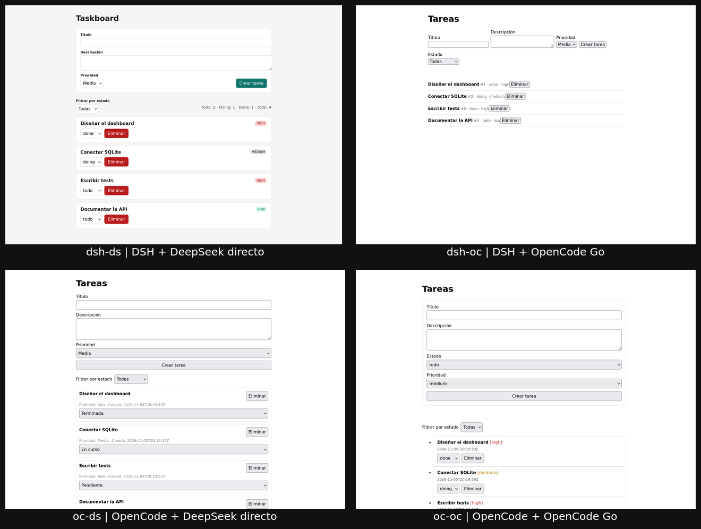
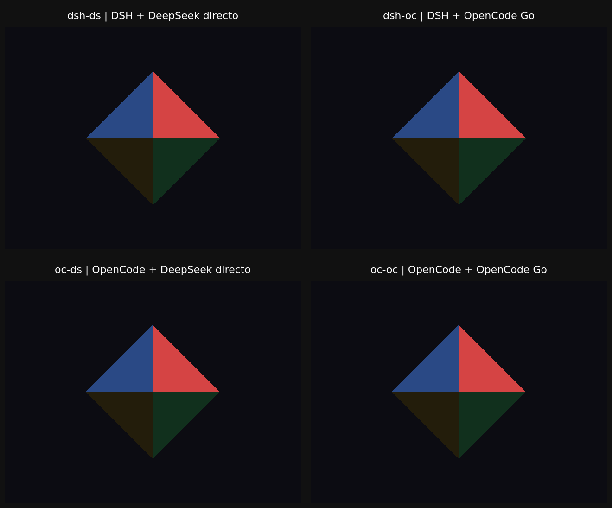
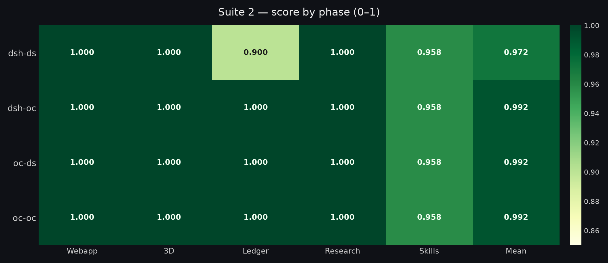

# DSH vs OpenCode — DeepSeek V4.1 Flash benchmark

Two suites, **40 official headless sessions**, one model at `max` effort:
**DeepSeek V4.1 Flash**. The question: when people say “OpenCode serves a
dumber model than DeepSeek direct”, is it the model, the harness, or the
provider?

**Short answer:** we found **no evidence that the OpenCode Go gateway degraded
the model**. The observable differences were latency and tool-loop behaviour,
not correctness.

> Exploratory benchmark: one run per cell/phase, ceiling effects, no
> statistical significance. Read the limitations before quoting numbers.

## TL;DR

| | Result |
|---|---|
| **Quality** | Tie: `oc-oc`, `oc-ds`, `dsh-oc` = **0.9917**; `dsh-ds` = **0.9717** |
| **Speed** | `oc-ds` **669 s**; `dsh-oc` **2016 s** |
| **Cost** | `oc-oc` **$0.137** nominal / **$0** under plan; `oc-ds` **$0.093** measured |
| **Value winner** | **`oc-oc`** (OpenCode + OpenCode Go) |
| **Speed winner** | **`oc-ds`** (OpenCode + DeepSeek direct) |
| **Only real failure** | `dsh-ds` rounding bug in `ledger`: `apply_discount(1001, 50)` returned 500 instead of 501 |

## Design

2×2 matrix, same model and effort:

| Cell | Harness | Provider |
|---|---|---|
| `dsh-ds` | DSH `headless` | DeepSeek direct |
| `dsh-oc` | DSH `headless` | OpenCode Go |
| `oc-ds` | OpenCode `run --standalone` | DeepSeek direct |
| `oc-oc` | OpenCode `run --standalone` | OpenCode Go |

- Model verified: `GET https://api.deepseek.com/models` returns
  `id: deepseek-flash`, `name: "DeepSeek-V4.1-Flash"`. The gateway serves
  `deepseek-v4.1-flash` with the same name.
- DSH request headers record `reasoningEffort: max`; OpenCode records
  `variant: "max"`.
- Four worktrees, four `DSH_HOME`/`XDG_*` environments, four synthetic test
  vaults, bubblewrap isolation, hidden tests outside the sandbox.
- Cell order was shuffled per phase; the worktree was reset before each phase.

## Results

### Suite 2 — webapp, 3D, bugfix, research, skills

| Cell | Webapp | 3D | Ledger | Research | Skills | Mean |
|---|---:|---:|---:|---:|---:|---:|
| `dsh-ds` | 1.000 | 1.000 | **0.900** | 1.000 | 0.958 | **0.9717** |
| `dsh-oc` | 1.000 | 1.000 | 1.000 | 1.000 | 0.958 | **0.9917** |
| `oc-ds` | 1.000 | 1.000 | 1.000 | 1.000 | 0.958 | **0.9917** |
| `oc-oc` | 1.000 | 1.000 | 1.000 | 1.000 | 0.958 | **0.9917** |

| Cell | Wall total | Tools | Cost nominal | Cost actual |
|---|---:|---:|---:|---:|
| `dsh-ds` | 955.7 s | 138 | $0.237103 | n/a |
| `dsh-oc` | 2016.4 s | 169 | $0.183264 | n/a |
| `oc-ds` | **669.1 s** | 110 | $0.186809 | **$0.093405** |
| `oc-oc` | 984.5 s | 127 | **$0.136964** | **$0.000000** (plan) |

- Webapp: all four passed **13/13** hidden tests (REST, SQLite, validation,
  pagination, SQL injection, concurrency, persistence, frontend markers).
- 3D: all four passed **10/10** hidden tests (projection, culling, z-buffer,
  lighting, near clip, validation, PPM).
- Research: all four passed, 4–5 real `sqlite.org` sources, ≤ 400 words.
- Skills: all four created the vault note and the real `dotpm` task, found the
  four `ledger` bugs and 5 of 6 seeded security issues.

### Suite 1 — coding, web, vision, skills

| Cell | Coding hidden | Vision | Web sources verified | Wall total | Cost nominal | Cost actual |
|---|---:|---:|---|---:|---:|---:|
| `dsh-ds` | 10/10 | 5/5 | 12/14 (2 GitLab blocked) | 825.1 s | $0.196140 | n/a |
| `dsh-oc` | 10/10 | 5/5 | 6/6 | 721.5 s | $0.102958 | n/a |
| `oc-ds` | 10/10 | 5/5 | 10/10 | 610.9 s | $0.199287 | $0.099644 |
| `oc-oc` | 10/10 | 5/5 | 10/10 | 927.5 s | $0.105187 | $0.000000 |

All four identified the NE555 astable, `686 Hz`, `52.4 %` duty and the
`RESET` tied to `GND` inconsistency.

## Cross-check: external harness leaderboard (Nov 2026)

This repo isolates the **provider** with two harnesses. The comparison was
orchestrated from Pi so the harness under test did not also drive the
evaluation. A separate public benchmark isolates the **harness** with the model
fixed, which is the other half of the picture. [Joël Niklaus's Harness Leaderboard](https://huggingface.co/spaces/joelniklaus/harness-leaderboard)
runs ten coding-agent harnesses on the same open-weight models, same provider,
same reasoning effort, three attempts per task, with 95% confidence intervals.
At v0.1.6 (2026-11-13 UTC), across GLM-5.3-Flash, DeepSeek-V4.1-Flash and Flint
on Terminal-Bench 2.1 and DeepSWE v1.1:

| Harness | Overall | $ per solved task | Terminal-Bench | DeepSWE |
|---|---:|---:|---:|---:|
| OpenCode | **52.0%** | $0.45 | **60.4%** | 43.6% |
| DSH | 50.4% | $0.53 | 55.8% | **45.1%** |
| Pi | 48.6% | **$0.29** | 56.3% | 40.9% |

OpenCode, mini-swe-agent, DSH and Kimi Code share the statistical first place;
OpenCode has the highest raw average. Per model:

| Model | OpenCode | DSH | Pi |
|---|---:|---:|---:|
| GLM-5.3-Flash (low + high) | **62.4%** | 60.1% | 62.0% |
| DeepSeek-V4.1-Flash (low + high) | **70.6%** | 70.5% | 65.8% |
| Flint | **23.1%** | 20.7% | 18.0% |

Two results matter for this repo:

- On **DeepSeek-V4.1-Flash**, the model used in this 2x2, OpenCode and DSH are
  statistically tied at 70.6% and 70.5%, while Pi is 65.8%. The provider swap
  here (OpenCode Go vs DeepSeek direct) moved quality less than the harness
  choice moves it on the external board.
- **DSH wins DeepSWE** (45.1%) but is eighth on Terminal-Bench (55.8%) because
  it shuts down the background services it started when the session ends. The
  board's author reports 2/36 passes on the three server tasks for DSH versus
  36/36 for OpenCode. That is a different failure mode from the `dsh-ds`
  rounding bug in this repo, but the same lesson: the harness, not the model,
  decides whether the task is complete.

The external board does not contradict the 2x2; it reinforces the reading that
the OpenCode Go gateway was not the problem. If anything, harness choice moved
scores more than the provider swap did. Caveats are the same: one operator,
headless runs, open-weight models only, and overlapping confidence intervals at
the top. The numbers are a snapshot; the board's changelog moves them.

## Visual evidence

The sessions were headless: there is no screen recording. These images are
reconstructions from the submitted code and the aggregate results.

Aesthetics were **not** scored. In the webapp captures `dsh-ds` looks more
polished, but the hidden tests only check function; visual style is not a
provider-quality metric.

**Webapp UIs** (same four synthetic tasks, each cell's submitted frontend):



**3D renderer** (same octahedron scene, each cell's submitted renderer; identical
output is the expected parity):



**Score heatmap**:



More: `visuals/suite2-time.png`, `visuals/suite2-cost.png`,
`visuals/suite1-time.png`, `visuals/suite1-cost.png`,
`visuals/vision-schematic.png`. See [`visuals/README.md`](visuals/README.md)
for provenance and reproduction.

## What this is

- A reproducible **methodology** with tasks, hidden acceptance tests, graders,
  isolation scripts and starter code.
- A **snapshot of results** with reports, aggregates and run order.
- A set of **tables and a Spanish video-friendly report** in
  [`docs/report-es.md`](docs/report-es.md).

## What this is not

- Not a leaderboard. One run per cell/phase, no confidence intervals.
- Not a TUI benchmark. DSH ran `headless`; OpenCode ran `run --standalone`.
- Not a Mistral benchmark. Mistral was not tested.
- Not proof that all four combinations are identical. It is evidence of
  **no gross gateway degradation** on these tasks.

## Repo layout

```
bench/
  bin/          # sandbox, runner, reset, snapshot, dotpm check
  tasks/        # phase prompts
  tests/        # hidden acceptance tests
  graders/      # automated grading
  patches/      # outer-sandbox overlay
  tools/        # env/vault builders, key bridge, collector
  seed/         # starter repository for all phases
  reference/    # reference implementations (validated the hidden tests)
docs/
  report-es.md  # full Spanish report, video-friendly
results/
  REPORT.md, REPORT2.md, SOURCE-VERIFICATION.md
  aggregate*.json, aggregate*.csv, run-order.txt
visuals/
  webapp-*.png, render3d-*.png, suite*-*.png
  README.md, make_visuals.py
```

## Reproduce

See [`bench/README.md`](bench/README.md). You need DSH, OpenCode, Python 3.14,
bubblewrap, and `dotpm` + Obsidian for phase 5.

**Warning:** `bench/tests/` and `bench/reference/` are public. If you reuse
this benchmark for new agent runs, create a new holdout or remove those
directories from the agent environment.

## Transparency

- 40 official sessions, plus one rerun. One `oc-oc` run listed `/tmp` and saw
  **file names** from a reference copy left during validation; it did not read
  the contents. The run was excluded, `/tmp` was isolated in the sandbox, and
  the phase was rerun. The rerun is the one reported.
- The real Obsidian vault was not written during the runs. The test Obsidian
  instance was closed afterwards.
- No API keys are stored in this repository.

## License

- **Code** (`bench/`): Apache-2.0 — see [`LICENSE`](LICENSE).
- **Documentation and results** (`docs/`, `results/`): CC BY 4.0 — see
  [`LICENSE-MEDIA`](LICENSE-MEDIA).

## Links

- Full Spanish report: [`docs/report-es.md`](docs/report-es.md)
- External cross-check: [Harness Leaderboard](https://huggingface.co/spaces/joelniklaus/harness-leaderboard)
- Suite 2 report: [`results/REPORT2.md`](results/REPORT2.md)
- Suite 1 report: [`results/REPORT.md`](results/REPORT.md)
- Source verification: [`results/SOURCE-VERIFICATION.md`](results/SOURCE-VERIFICATION.md)
